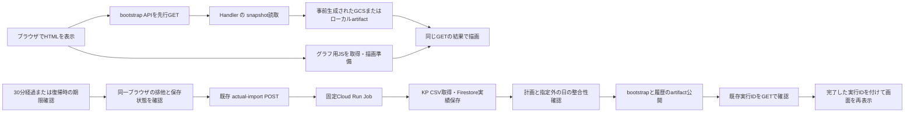

# ダッシュボードの30分自動取込み契約

## 対象

ブラウザを開いている間、当日の実績取得・保存・表示公開を30分間隔で行う。
画面を開いた直後には取込みPOSTを送らない。間隔は同じブラウザ内の直近の開始から測る。
手動で選択した過去日は自動取込みに引き継がず、空の本文 `{}` でサーバーの当日判定を使う。
予測原本、計算、制御設定、制御ジョブの動作は変更しない。

## リクエストとデータの経路

初期表示のHTTP経路は変更前後とも、HTML 1件、CSS/JS 7件、bootstrap 1件。
履歴は明示的な期間移動で遅延取得する。初期表示の履歴GETは0件。
bootstrapは埋込み済みの行があれば取得せず、先行GETがあればその結果を消費する。
先行取得の失敗を直ちに捕捉し、描画側へ伝える。同じ失敗リクエストを二重に送らない。
`actual_import` クエリーによる受領票確認・キャッシュ更新も先行GETに引き継ぐ。

## 状態と責任

- `scheduleActualImport`: 期限、Web Locksによる同一ブラウザ内の排他、localStorageによるタブ間共有。
- `bindActualImport`: 日付入力、POST、sessionStorageの既存実行ID、受領票の監視、結果表示。
- `DashboardApi`: bootstrapの先行取得と描画時の一度だけの受渡し。
- サーバー・取込みJob: 既存の認証、実行所有権、保存、整合性確認、公開を維持する。

| 事象 | 次の動作 | 自動POST |
| --- | --- | --- |
| 最初の30分が未経過 | 画面のみ表示 | なし |
| 期限到来・未処理なし | 既存の当日取込みを開始 | 1件 |
| 別タブが実行中 | 排他を待たず見送り、後で確認 | なし |
| 実行IDが判明済み | 同じ実行IDの受領票を確認 | なし |
| 受付結果不明・保存結果不明・busy | 再送せず確認を待つ | なし |
| 保存結果と終了が確認できる失敗 | 自動取込みを一時停止し、手動の復旧操作を許可 | なし |
| 成功・partial | タブへ完了を通知し、更新済み画面を表示 | なし |
| スリープから復帰し複数回分が経過 | 今の当日分を1回だけ処理 | 最大1件 |
| 共有状態の破損・排他機能が利用不可 | 自動取込みを無効化し、手動経路を維持 | なし |

送信前の共有状態保存に失敗したら送信しない。
送信後の共有状態保存の失敗は、既に受け付けられた実行の監視を止めない。
同じブラウザのタブ間調整であり、別端末・別プロファイルの30分枠を集約する機能ではない。
PCの停止中やブラウザ終了中の定時実行は提供しない。

## 性能と検証

初期bootstrapは事前生成artifactの高速経路を維持し、artifactがある場合のDB読取り禁止、
gzip/ETag、版付き静的資源のimmutableキャッシュ、履歴の遅延取得を既存回帰で検証する。
本変更はGETの順序を並行化するもので、bootstrapの転送量やバックエンド読取り数は減らさない。
自動取込みに伴うPOSTと受領票確認は追加される。端末間の実行集約は行わない。

既存の本番実行ログには、取込み1回でrevision照合11回・144,598 document readsの観測がある。
30分運転ではこの重い経路の実行頻度も増える。今回、履歴改訂・削除や計画混在を検出する検査は削らない。
取込み時間の次の短縮検討対象は、同じ段階の複数の照合結果を、同じ読取時点から算出して重複読取りを減らすこと。
採用には、bootstrap/履歴/指定日除外の各スコープ、過去日訂正・削除、公開前後の変更検知が現行と一致する検証を要する。

回帰テストは `tests/test_dashboard_actual_import.js`、`tests/test_dashboard_modules.js`、
`tests/test_dashboard_bootstrap.js`、`tests/test_dashboard_server.py` に保持する。
ローカルブラウザ比較は同じ保存済み実データで表示値・初期リクエスト数を比較し、
時計を進めて2タブから1件だけのPOSTと両タブの表示更新を確認する。本番の取込み試験とは区別する。

### 2026-11-20のローカル検証記録

- 適用静的検査: Ruff、Import Linter 3契約、mypy 258ファイル、全管理JSのOxlint/構文、compileallは通過。
  既存の `dashboard.js` の空spread fallback警告1件は今回の変更と無関係で、変更していない。
- Pythonの関連回帰・歴史的障害保護: 83件成功。全Pythonテストの実行結果ではない。
- Node: 取込み34シナリオ、bootstrap、API、計算、時間別SOC、PVモデル表示が成功。
- ローカルChromium: 保存済み本番bootstrapを使用し、8グラフの系列値が旧経路と一致。
  初期bootstrapは1件、履歴0件。2タブの自動取込みは模擬POSTが1件で、両タブが再表示した。
  PCと幅390pxの画面を確認し、横方向のはみ出しはない。
- 通信遅延150ms・同じデータ・各5回の最終比較で、2〜5回目の表示完了中央値は615.55ms→564.10ms。
  約8.4%短縮したローカル測定であり、本番反映後の改善率は未計測。
- 初期リクエスト数とbootstrapの転送量は同じ。JSはローカルgzip比較で合計約1.6KB増加。
- `security_check`、`git diff --check` は成功。`.env` はignoreされ、変更対象に含めていない。
- CodebaseMemoryは `ready` を確認し、`main`/`bindActualImport`/`run`/`monitor` の1-hopと
  `capture_date_refresh`/`publish_date_refresh` の直接依存を確認した。曖昧な外部SDK名の辺は根拠にせず、
  `app/dashboard/server.py`、`date_snapshots.py`、`snapshots.py` の対象範囲と既存ログで検証した。
  オンデマンド操作後、CodebaseMemory daemonが残っていないことを確認した。
- 残課題は取込みJobの整合性照合コスト。上記ローカル検証時点では本番未反映。
  その後のリリース・本番受入の結果は、この変更のPRに記録する。
- 最終確認で、従来のsessionStorageにある受付不明状態が別タブへ共有されず、
  自動POSTが1件発生する不具合を追加テストで再現した。既存の保留状態も共有状態へ移す修正後は0件。
  新規共有状態・初期化済み共有状態の両方をNodeで検証し、ローカルChromiumの2タブでも追加POST 0件を確認した。
