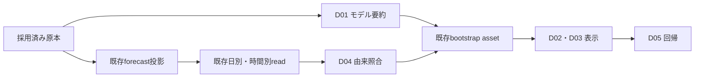

# NEW100ダッシュボード表示の追加実装パッケージ

2026-10-12。基準HEAD `d401b15de199ff8f1215935d01080a67a4c95266`と、今回のNEW100未commit作業ツリーが調査対象。
2026-10-12のユーザー指示で実装を開始する。固定軸の見切れと保存元からの実測欠測復元を追加対象とする。

## 入口

最初に [全表示の一覧](ui-display-inventory.md)、[供給経路の監査](data-path-audit.md)、[共通契約](contracts.md) を参照する。
実装担当は全監査文書を再読せず、index.jsonで担当D-stepの必要ファイルだけを読む。
変更可能範囲は本パッケージの指定symbolと追加承認C08/C09に限定する。

## 順序

| step | 目的 | 出口 |
| --- | --- | --- |
| D01 | 採用原本から小さなモデル要約を作り同世代を結ぶ | NEW/legacy/unknown/missingの判別と小さな要約 |
| D02 | 学習・係数・説明式・時刻・由来を適切に表示する | 旧物理係数との混同を防ぐ |
| D03 | 時間別PV/load/SOC・合計・最大点の根拠を分ける | 保存SOC優先、参考推定区別、欠測と有効0の区別 |
| D04 | 日次レビューの予測世代と計画由来fieldを照合する | 混在する金融予想/目標だけを未確認表示 |
| D05 | 全表示・異常/legacy/backend/performance回帰を確認する | 導入前検証証拠、未実証項目を分離 |
| D06 | CSV同期・日計保存の元データ修復 | unchanged原本でも日計修復、欠測0化防止。D05前に完了 |

正本はstepsの変更対象/禁止/変数/test/PASS条件とcontractsのschema。
各stepの内部helperは隣接moduleに置き、新class・汎用framework・env/mode flag・DBschema・endpointを増やさない。元データ修復はD06の保存側で行い、dashboardで新補完は行わない。
既存SOC・料金・制御計算は修正しない。今回直すのは表示の接続、根拠の区別、既存読取fieldの欠落だけ。

担当stepだけの参照一覧は次で取得する。

    python docs/current/architecture/pv_clear_ghi_new100/dashboard_followup/tools/validate_followup.py --step D03

## 状態と残件

D01〜D06のローカル実装・検証は完了。[実装結果](implementation-report.md)に全体1,297件と追加Node3群、Chrome合成入力表示を記録した。
本番データ修復・本番asset/DB・Firestore/GCS競合は別の検証条件であり、未実施/未実証として保持する。
既存G04/G06/G07/G08は未完。表示設計のレビュー合格だけで本番導入を合格にしない。

詳細な確定/不確定/変更禁止の判断とレビュー結果はreview.mdへ記録する。
[今回の報告](report.md) は、確定した欠落・正常確認・保持/別残件・実装待ちをまとめる。
